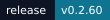
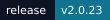
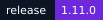
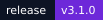
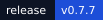

<a href="https://github.com/C0sm0cats">
  <picture>
    <source media="(prefers-color-scheme: dark)" srcset="assets/banner-dark.svg">
    
  </picture>
</a>

<picture><source media="(prefers-color-scheme: dark)" srcset="assets/sections/window-dark.svg"></picture>

<a href="https://github.com/C0sm0cats/SnapTess"><picture><source media="(prefers-color-scheme: dark)" srcset="assets/headers/snaptess-dark.svg?v=511d52dd"></picture></a>  
   Automatic window tiling for <strong>GNOME 50–51 on Wayland</strong>. Grid &amp; split layouts, drag-to-snap, Layout Studio, linked tile resize, keyboard-driven focus and independent spaces per monitor.  <code>GNOME Shell extension</code> · <code>GJS</code> · <code>Wayland</code>

 

<a href="https://github.com/C0sm0cats/SmartGrid"><picture><source media="(prefers-color-scheme: dark)" srcset="assets/headers/smartgrid-dark.svg?v=4c033e9f"></picture></a>  
   Automatic tiling window manager for <strong>Windows 10/11</strong> — a FancyZones alternative. Layout studio, custom grids, snap &amp; swap, virtual desktops, global hotkeys.  <code>Python</code> · <code>Qt</code> · <code>Win32</code>

 

<picture><source media="(prefers-color-scheme: dark)" srcset="assets/sections/workspace-dark.svg"></picture>

<a href="https://github.com/C0sm0cats/GMAIL"><picture><source media="(prefers-color-scheme: dark)" srcset="assets/headers/gmail-dark.svg?v=e063a410"></picture></a>  
   <strong>Gmail in your terminal.</strong> Browse and triage Inbox, Sent, Spam and Trash (archive, star, undo), and save emails as PDFs with their attachments.  <code>Python</code> · <code>TUI</code> · <code>Gmail API</code> · <code>Playwright</code>

 

<a href="https://github.com/C0sm0cats/GDRIVE"><picture><source media="(prefers-color-scheme: dark)" srcset="assets/headers/gdrive-dark.svg?v=0281495d"></picture></a>  
   <strong>Google Drive in your terminal.</strong> Two-way sync of the folders you pick across My Drive, shared items and shared drives, preview every change on both sides, then sync safely: conflicts kept, deletions to the trash, Docs/Sheets/Slides export.  <code>Python</code> · <code>TUI</code> · <code>Textual</code> · <code>Drive API</code>

 

<picture><source media="(prefers-color-scheme: dark)" srcset="assets/sections/ai-dark.svg"></picture>

<a href="https://github.com/C0sm0cats/lethe"><picture><source media="(prefers-color-scheme: dark)" srcset="assets/headers/lethe-dark.svg?v=4ab59d47"></picture></a>  
   <strong>Browse, resume and forget your Claude Code and Codex sessions</strong> from one terminal picker. Live preview, resume in the original directory, bulk cleanup with undo; running sessions are never touched. Scriptable with <code>--json</code>, <code>--dry-run</code> and cron.  <code>Bash</code> · <code>fzf</code> · <code>Claude Code</code> · <code>Codex</code>

 

<picture><source media="(prefers-color-scheme: dark)" srcset="assets/sections/writing-dark.svg"></picture>

<a href="https://github.com/C0sm0cats/the-source"><picture><source media="(prefers-color-scheme: dark)" srcset="assets/headers/the-source-dark.svg?v=b2ab760c"></picture></a>  
  A bilingual (FR/EN) vision of <strong>consciousness, infinity and return</strong>, told one idea at a time, each with an interactive generative figure. Also as two illustrated books.  <code>Generative art</code> · <code>FR / EN</code>  <a href="https://c0sm0cats.github.io/the-source/en/"><picture><source media="(prefers-color-scheme: dark)" srcset="assets/buttons/read-online-dark.svg"></picture></a> <a href="https://c0sm0cats.github.io/the-source/"><picture><source media="(prefers-color-scheme: dark)" srcset="assets/buttons/lire-en-francais-dark.svg"></picture></a>

 

<picture><source media="(prefers-color-scheme: dark)" srcset="assets/sections/game-dark.svg"></picture>

<a href="https://github.com/C0sm0cats/naorush"><picture><source media="(prefers-color-scheme: dark)" srcset="assets/headers/naorush-dark.svg?v=b92c035b"></picture></a>  
  A <strong>2D browser platformer</strong> set in Inetum's offices, Rick Dangerous / Prince of Persia style: cross five stages, convince the directors, get the raise envelope signed. No engine dependency, PC/tablet/mobile.  <code>JavaScript</code> · <code>WebGL2</code>  <a href="https://c0sm0cats.github.io/naorush/"><picture><source media="(prefers-color-scheme: dark)" srcset="assets/buttons/play-now-dark.svg"></picture></a>

 

<picture><source media="(prefers-color-scheme: dark)" srcset="assets/sections/activity-dark.svg"></picture>

<picture><source media="(prefers-color-scheme: dark)" srcset="assets/live/activity-dark.svg"></picture>

<picture><source media="(prefers-color-scheme: dark)" srcset="assets/live/contrib-dark.svg"></picture>

<picture><source media="(prefers-color-scheme: dark)" srcset="assets/sections/stack-dark.svg"></picture>

<picture>
  <source media="(prefers-color-scheme: dark)" srcset="assets/stack-dark.svg">
  
</picture>

 

<a href="https://github.com/C0sm0cats?tab=repositories">
  <picture>
    <source media="(prefers-color-scheme: dark)" srcset="assets/footer-dark.svg">
    
  </picture>
</a>
